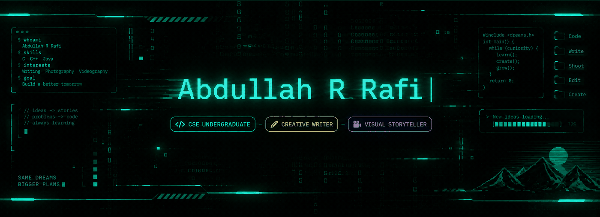

<div align="center">

  
  <br/><br/>

  
  
  

  <h3>Ideas into stories. Problems into code.</h3>

  
  <br/><br/>

  
  
  

</div>

---

##  — About Me

Hi, I'm **Abdullah R. Rafi**, a CSE undergraduate exploring the space where **technology, storytelling, and visual creativity** meet.

I enjoy understanding how things work, turning ideas into clear stories, and learning by building. My interests span programming and problem-solving, alongside creative writing, visual storytelling, photography, and video.

- 💻 **Code:** C, C++, Java, HTML and the fundamentals of problem-solving.
- ✍️ **Create:** Creative writing, content, and visual storytelling.
- 🎬 **Visualize:** Photography, videography, and creative content.
- 🌱 **Currently growing:** Database management and practical programming skills.

---

## — Find me around the web

<div align="center">

  <a href="https://linkedin.com/in/abdullahrafi98">
    
  </a>
  <a href="https://behance.net/abdullahrrafi8">
    
  </a>
  <a href="https://instagram.com/rafiabdullah08">
    
  </a>
  <a href="https://facebook.com/ra.fi.258437">
    
  </a>
  <a href="mailto:rafiabd98@gmail.com">
    
  </a>

</div>


## — My Creative Workspace


<div align="center">
  <table>
    <tr>
      <td align="center" width="50%">
        <h3>⌘ CODE</h3>
        <p>Logic · Structure · Problem Solving</p>
        
        
        
        
        
        
      </td>
      <td align="center" width="50%">
        <h3>✳ CREATIVE</h3>
        <p>Story · Image · Visual Direction</p>
        
        
      </td>
    </tr>
  </table>
</div>


### Tools in my workflow

<p align="left">
   
  
  
  
</p>

---

## — GitHub activity

<div align="center">

  
  
  <br />
  
</div>

---

## — Beyond the terminal

<div align="center">

| CODE SIDE | CREATIVE SIDE |
|:---:|:---:|
| Programming fundamentals | Creative writing |
| Data structures & algorithms | Content and copywriting |
| Logical thinking | Visual storytelling |
| Learning by building | Photography & videography |
| Exploring new tools | Creative direction |

</div>

---
## — A thought to keep
<div align="center">
  
  
  

</div>
<!-- Contribution snake appears after the GitHub Actions workflow is configured. -->
<div align="center">
  <picture>
    <source media="(prefers-color-scheme: dark)" srcset="https://raw.githubusercontent.com/rafiabdullah8/rafiabdullah8/output/github-contribution-grid-snake-dark.svg" />
    <source media="(prefers-color-scheme: light)" srcset="https://raw.githubusercontent.com/rafiabdullah8/rafiabdullah8/output/github-contribution-grid-snake.svg" />
    
  </picture>
</div>
```
